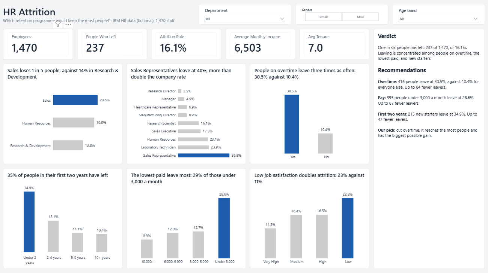

# HR Attrition Analysis

**Which retention programme would keep the most people?** An analysis of 1,470 employees in PostgreSQL and Power BI, comparing three options for one retention budget.

**Tools:** Excel · PostgreSQL · Power BI (DAX, star schema)

## Demo

<!-- In the GitHub editor, drag images/slicer_demo.mp4 onto the line below to embed the video -->

https://github.com/user-attachments/assets/cbd84a5f-122f-416d-8f35-496bee869c05

A 30-second walkthrough of the slicers filtering the page. [Download the video](images/slicer_demo.mp4)

## The problem

A company of about 1,500 people is losing too many staff, and each leaver costs months of salary to replace and train. The HR director has budget for one retention programme next year:

1. Cut overtime, by hiring cover for the teams that rely on it
2. Raise pay for the lowest-paid staff
3. Improve the first two years, with better onboarding and a mentor for every new starter

Who is leaving, and which programme would keep the most people?

*The company story is invented for this project. The data is a fictional dataset created by IBM data scientists; no real people are in it.*

## The data

[IBM HR Analytics Employee Attrition & Performance](https://www.kaggle.com/datasets/pavansubhasht/ibm-hr-analytics-attrition-dataset): 1,470 employees, 35 columns, one row per person. See [data/README.md](data/README.md).

## What I did

1. **Checked the data in Excel and PostgreSQL:** no duplicates, no blanks, no impossible values, and three columns that never change ([cleaning log](docs/cleaning_log.md), [Excel checks](docs/excel_checks.md)).
2. **Shaped it in SQL:** dropped seven columns, added a 1/0 leaver flag, and built age, tenure and income bands ([build](sql/03_build_employees.sql)).
3. **Built lookup tables and joins** for the coded education and satisfaction columns, giving a star schema ([lookups](sql/04_lookup_tables.sql)).
4. **Answered 11 questions in SQL**, always reading group size next to the rate, and compared the three programmes in one query ([queries](sql/05_business_questions.sql)).
5. **Connected Power BI straight to PostgreSQL**, linked the three tables, and built a one-page dashboard with DAX measures ([measures](docs/dax_measures.md)).

## What I found

- **One in six people has left:** 237 of 1,470, an attrition rate of 16.1%.
- **Overtime:** people on overtime leave at 30.5%, three times the 10.4% for everyone else.
- **Pay:** people paid under 3,000 a month leave at 28.6%.
- **New starters:** 34.9% of people in their first two years have left.
- **Roles:** Sales Representatives leave at 39.8%, more than double the company rate.
- **Satisfaction:** low job satisfaction doubles attrition, 22.8% against 11.3% for very high.
- **Education** makes little difference (10% to 18% across all levels).

## Recommendation

| Programme | People reached | Their attrition | Everyone else | Leavers avoided (best case) |
| --- | --- | --- | --- | --- |
| Cut overtime | 416 | 30.5% | 10.4% | 84 |
| Raise lowest pay | 395 | 28.6% | 11.5% | 67 |
| Improve first two years | 215 | 34.9% | 12.9% | 47 |

**Pick: cut overtime.** It reaches the most people and has the largest possible gain. Start with the 114 people who are both on overtime and paid under 3,000, where 56% have left.

## Limits

- The data shows that overtime and leaving go together. It cannot prove that one causes the other.
- The three groups overlap, so the leavers-avoided figures cannot be added together.
- Leavers avoided is a best case that assumes a programme works completely.
- The dataset is synthetic, and the company story is invented.

## How to reproduce

1. Download the data ([data/README.md](data/README.md)).
2. Run the files in [sql](sql) in number order in PostgreSQL. Each file has the expected result as a comment under every check.
3. Open [powerbi/hr_dashboard.pbix](powerbi/hr_dashboard.pbix) in Power BI Desktop. The data is saved inside the file; to refresh it, point it at your own PostgreSQL database.

## Files

| Folder | What is in it |
| --- | --- |
| [sql](sql) | Five SQL files, run in number order |
| [powerbi](powerbi) | The dashboard (.pbix and PDF) and the theme file |
| [docs](docs) | Cleaning log, data dictionary, Excel checks, DAX measures |
| [images](images) | Dashboard screenshot and slicer demo |
| [data](data) | Where to download the data |

Data: IBM HR Analytics Employee Attrition & Performance, via Kaggle. Fictional data created by IBM.
